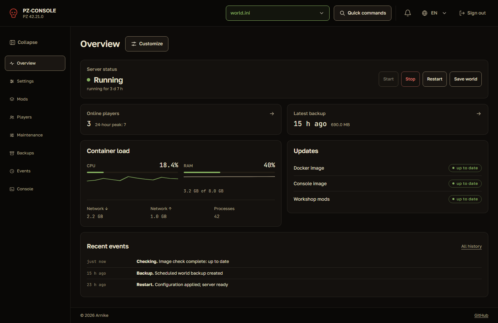

# PZ Console

PZ Console is a self-hosted control panel for one Project Zomboid dedicated server.
Manage Build 42 profiles and Workshop mods, monitor players and server load, and
run backups, updates, and restarts from a desktop or mobile browser. The interface
supports English and Russian and can be installed as a web app.

[See more screenshots](docs/screenshots/README.md)

## Quick start

Use Docker with Compose v2. For a new server, clone the repository and [configure
the supplied Compose project](docs/installation.md#new-server). Start the stack
with `docker compose up -d --build`, then sign in at `http://<host>:8081`.
The first game server startup downloads files from Steam.

To keep an existing server, [add the dashboard overlay](docs/installation.md#existing-compose-server)
and point it at the server's configuration and data volume. To deploy a prebuilt
panel, follow [Released images from GHCR](docs/installation.md#released-images-from-ghcr).

The panel controls the Docker host through its socket. Restrict access to a
trusted network or [configure an HTTPS reverse proxy](docs/installation.md#https-and-access).

## Workspaces

| Workspace | What you can do |
| --- | --- |
| Overview | Check status, load, updates, and recent events. Use **Customize** to reorder, hide, or add widgets. **Reset layout** restores the defaults. The browser saves the layout locally. |
| Settings | Edit INI and SandboxVars, review draft changes, and restore configuration history. |
| Mods | Manage Workshop packages, select ModIDs and dependencies, arrange load order and maps, and import or export modpacks. |
| Players | View the roster and activity history, locate players with the optional map integration, and kick or ban players through RCON. |
| Maintenance | Configure image and mod updates, scheduled restarts, chat announcements, watchdog recovery, and Telegram notifications. |
| Backups | Schedule, create, verify, download, and restore world archives. |
| Events | Filter the server activity journal. |
| Console | Send RCON commands and inspect or download container logs. |

Press `Ctrl/Cmd+K` to find commands and jump to sections.

## Documentation

- [Installation and environment variables](docs/installation.md)
- [B42 configuration and Workshop mods](docs/config-editor.md)
- [Server operations, backups, and API](docs/operations.md)
- [Player map setup](docs/player-map.md)
- [Development and checks](CONTRIBUTING.md)
- [Trusted extensions](docs/extensions.md)
- [Isolated B42 acceptance testing](docs/acceptance-b42.md)
- [Product scope](PRODUCT.md) and [design system](DESIGN.md)

## License

[MIT](LICENSE) © 2026 Arnike. [Bundled assets and tooling](THIRD_PARTY_NOTICES.md)
retain their upstream licenses. PZ Console is an independent community project
and has no affiliation with The Indie Stone.
