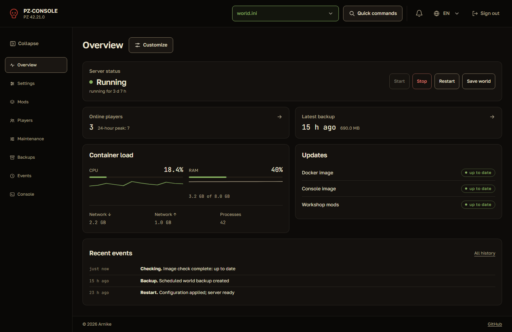
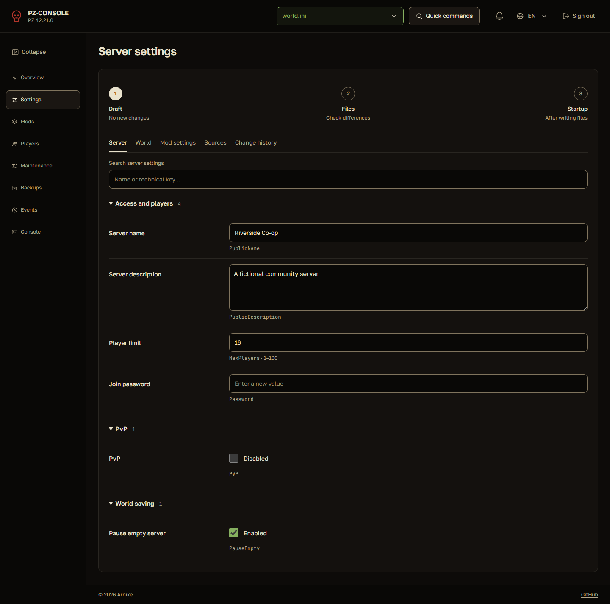
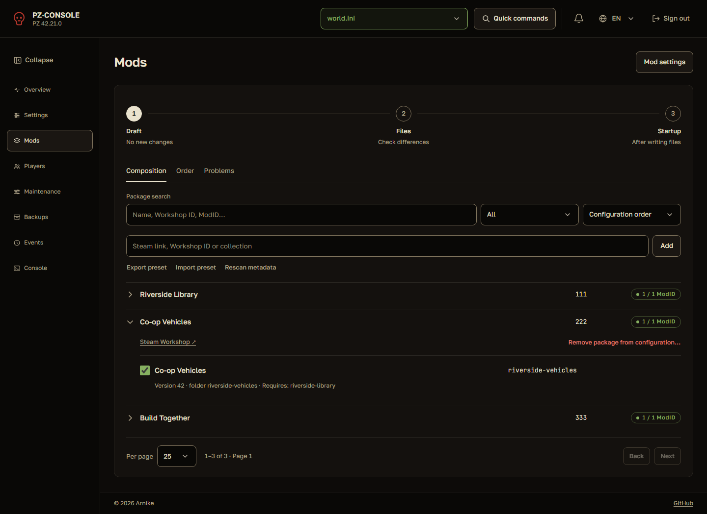
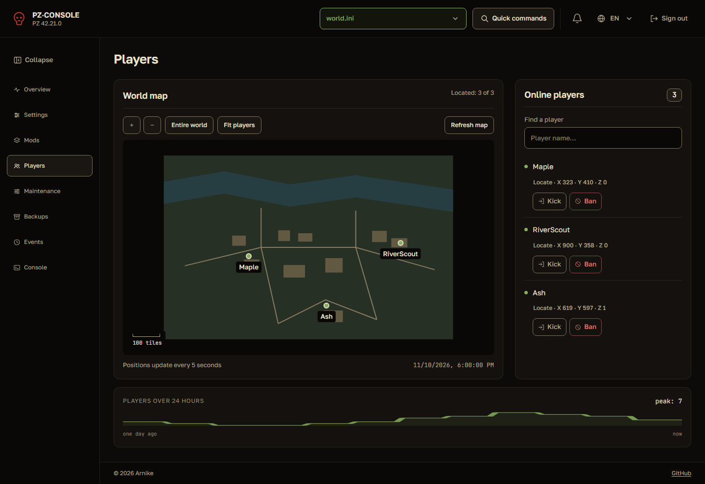
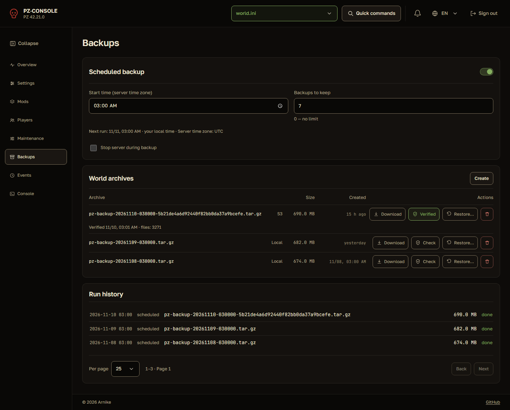
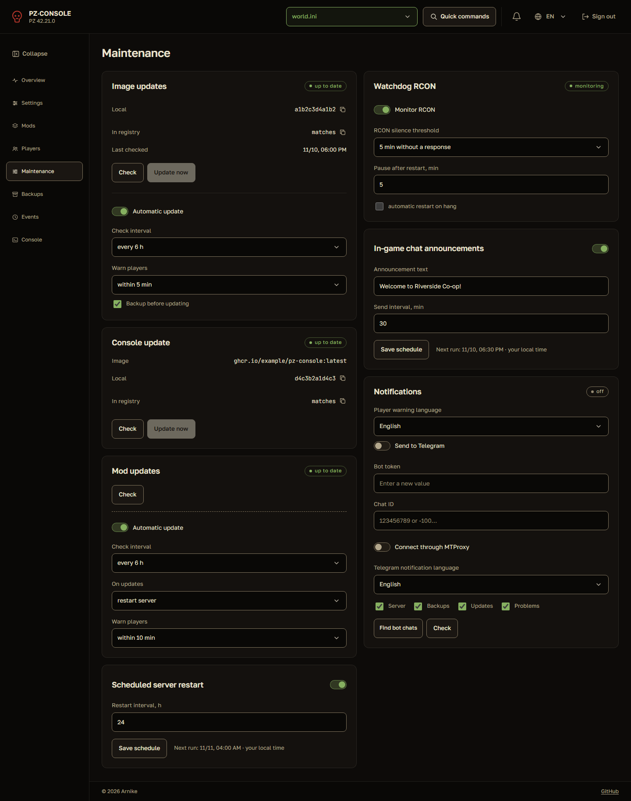
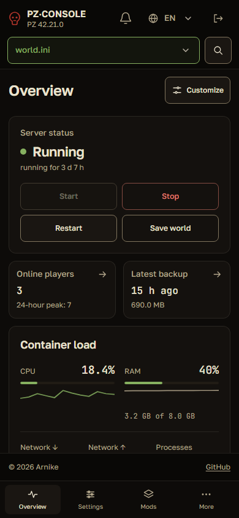

# Application screenshots

Chromium captures the current PZ Console interface with a fictional Riverside Co-op server.

## Desktop

### Overview



### Server settings



### Workshop mods



### Players



### Backups



### Maintenance



## Mobile



## Regenerate

Set up Python and Playwright using [Contributing](../../CONTRIBUTING.md#setup-and-checks).
Run the opt-in capture from the repository root.

PowerShell:

```powershell
$env:PZ_README_SCREENSHOTS = '1'
.\.venv\Scripts\python.exe -m pytest -q tests/browser/test_readme_screenshots.py --basetemp=.tmp-pytest/readme-screenshots
Remove-Item Env:PZ_README_SCREENSHOTS
```

Bash:

```bash
PZ_README_SCREENSHOTS=1 .venv-linux/bin/python -m pytest -q tests/browser/test_readme_screenshots.py --basetemp=.tmp-pytest/readme-screenshots
```

The capture overwrites the seven PNGs. It uses local assets, a temporary configuration
profile, and fictional player, map, Workshop, and backup data. The browser uses English,
UTC, and a fixed clock. Desktop captures are 1440 pixels wide and fit the page. The mobile
capture shows the visible 390 × 844 viewport.

Review all seven images before committing. Check that the data loaded, the content fits,
and the mobile navigation is visible.
